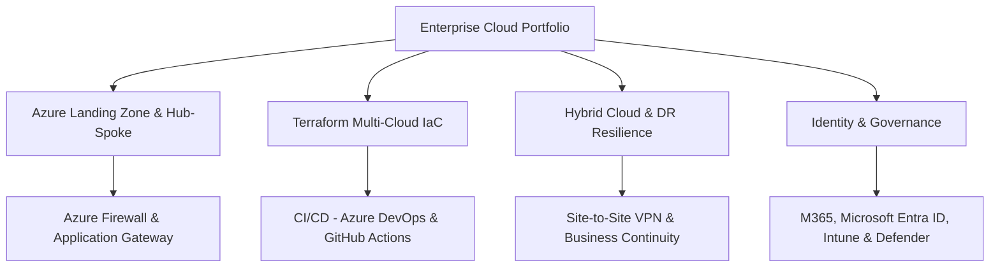

### ☁️ Senior Cloud Infrastructure Engineer | DevOps | Microsoft Azure | GCP | AWS | Terraform | CI/CD

**Cloud Architecture · Hybrid Infrastructure · Automation · High Availability · Security**

---

## 👋 About Me

I am a **Senior DevSecOps Engineer & Cloud Solutions Architect** with expertise in designing, implementing, and optimizing enterprise cloud platforms across **Microsoft Azure**, **AWS**, and **Google Cloud Platform (GCP)**.

My core focus is architecting **hybrid cloud environments**, **landing zones**, **hub-and-spoke networking**, **Infrastructure as Code (Terraform)**, and **disaster recovery (DR)** to ensure seamless business continuity, high availability, and operational resilience.

Currently working as a Senior Cloud Infrastructure Engineer at Advance International Co., leading multi-cloud initiatives, automated delivery workflows with Azure DevOps & GitHub Actions, and Microsoft 365 / Entra ID identity governance.

💼 Open to Cloud Infrastructure, Multi-Cloud Architecture, Azure DevOps, Platform Engineering, and Site Reliability roles.

---

## 🧭 Portfolio Delivery Map

---

## 🧰 Technology Stack

| Domain | Skills and Tools |
|---|---|
| ☁️ **Cloud Platforms** | **Microsoft Azure** (Primary), **Amazon Web Services (AWS)**, **Google Cloud Platform (GCP)** |
| 🏛️ **Cloud Architecture** | Hybrid Cloud, Landing Zones, Hub-and-Spoke Networks, High Availability (HA), Disaster Recovery (DR), Business Continuity, Cloud Migration, Modernization |
| 🌐 **Networking & Connectivity** | Azure Firewall, Network Security Groups (NSG), Application Gateway (WAF v2), Azure Load Balancer, Private Endpoints, Site-to-Site VPN, VNet Peering |
| 🏗️ **Infrastructure as Code** | **Terraform**, reusable modules, state management, drift detection, CloudFormation |
| 🔄 **CI/CD & Cloud Automation** | **Azure DevOps Pipelines**, **GitHub Actions**, Jenkins, PowerShell, Bash, Git |
| 🏢 **Microsoft Enterprise Suite** | Microsoft 365, Microsoft Entra ID (Azure AD), Intune, Defender for Cloud/Endpoint, Exchange Online, SharePoint, Teams, Purview |
| 📦 **Containers & Operating Systems** | Docker, Kubernetes, Windows Server, Ubuntu Linux, Red Hat Enterprise Linux (RHEL), CentOS, AlmaLinux |
| 🌐 **Web & Infrastructure** | Nginx, Apache, IIS, SSL/TLS, DNS, Virtual Machines, VPC / Virtual Networks, Cloud Storage |
| 🔒 **Security & Access Control** | IAM, Role-Based Access Control (RBAC), Multi-Factor Authentication (MFA), Data Encryption, Least Privilege |
| 📊 **Monitoring & Observability** | Azure Monitor, Log Analytics, Prometheus, Grafana, Metrics, Alerting & Proactive Incident Response |

---

## 🏅 Certifications & Education

* 🏅 **Microsoft Certified: Azure Administrator Associate** (AZ-104)
* 🎓 **Bachelor of Engineering (B.E.)** in Electronics and Communication Engineering — Rajiv Gandhi Technical University (2014)

---

## 🚀 Featured Projects & Deliverables

### 1. 🏢 Azure Enterprise Hub-and-Spoke Landing Zone
Enterprise-ready Terraform architecture featuring central Hub VNet with Azure Firewall, Application Gateway (WAF), Private Endpoints, and peered Spoke VNets for production workloads.
* **Tech**: `Terraform` `Azure Virtual Network` `Azure Firewall` `App Gateway` `NSG`
* **Outcome**: Established secure network segmentation, centralized egress routing, and zero-trust perimeter control.

### 2. 🔄 Multi-Cloud Infrastructure as Code with Terraform
Reusable, modular Terraform modules integrated with Azure DevOps CI/CD pipelines for automated provisioning across Azure and GCP environments.
* **Tech**: `Terraform` `Azure DevOps` `GitHub Actions` `GCP` `Bash`
* **Outcome**: Reduced environment provisioning time by 70% while enforcing parameter consistency and eliminate configuration drift.

### 3. 🛡️ Hybrid Cloud Architecture & Disaster Recovery Platform
Production-grade hybrid infrastructure connecting on-premises datacenters with Microsoft Azure via resilient Site-to-Site VPN tunnels and automated failover.
* **Tech**: `Azure Site Recovery` `Site-to-Site VPN` `Storage Accounts` `Azure Backup`
* **Outcome**: Met stringent RPO &lt; 15 mins / RTO &lt; 30 mins requirements ensuring seamless business continuity.

### 4. 🔐 Enterprise Identity & M365 Security Hardening
Enterprise-wide governance rollout of Microsoft Entra ID, Conditional Access policies, Multi-Factor Authentication (MFA), and Microsoft Intune endpoint compliance.
* **Tech**: `Microsoft Entra ID` `Microsoft 365` `Intune` `Microsoft Defender` `Purview`
* **Outcome**: Secured 1,000+ enterprise identities, enforced device compliance, and prevented unauthorized credential access.

### 5. 🐳 Containerized Microservices on Azure
Dockerized application deployment on Azure infrastructure featuring automated container builds, health monitoring, and reverse proxy routing.
* **Tech**: `Docker` `Kubernetes` `Nginx` `Azure VM / AKS` `Linux`
* **Outcome**: Standardized container delivery workflows and improved service deployment velocity.

### 6. 📊 Centralized Telemetry & Proactive Monitoring Suite
Comprehensive observability ecosystem aggregating infrastructure metrics, audit logs, and performance telemetry into centralized dashboards.
* **Tech**: `Azure Monitor` `Log Analytics` `Prometheus` `Grafana`
* **Outcome**: Reduced MTTR (Mean Time to Resolution) for critical production incidents through automated alerting.

---

## 🔒 How I Approach Cloud Infrastructure

* **Automate Everything (IaC First)**: Keep all infrastructure declarative, version-controlled, and testable using Terraform.
* **Architect for Resilience**: Design multi-zone redundancy, automated backup, and validated disaster recovery from day one.
* **Shift-Left Security & Zero Trust**: Enforce least privilege IAM, RBAC, encrypted channels, and private network endpoints.
* **Optimize for Efficiency (FinOps)**: Regularly audit utilization, rightsize resources, and leverage reserved instances/savings plans.
* **End-to-End Visibility**: Implement structured logging and proactive alerting so issues are detected before impacting users.

---

## 🤝 Connect

I welcome conversations about Azure Cloud Architecture, Hybrid Cloud, Terraform Automation, M365 Governance, and Infrastructure Engineering opportunities.

 

